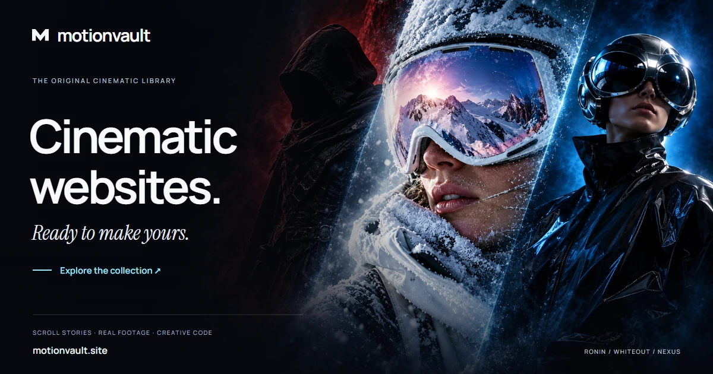
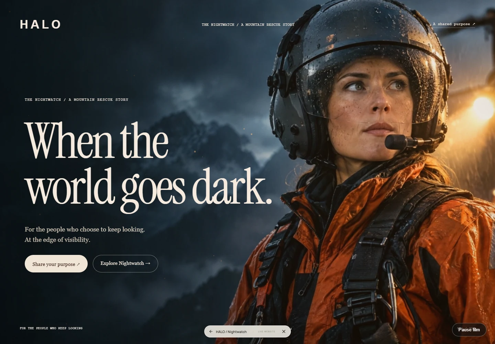
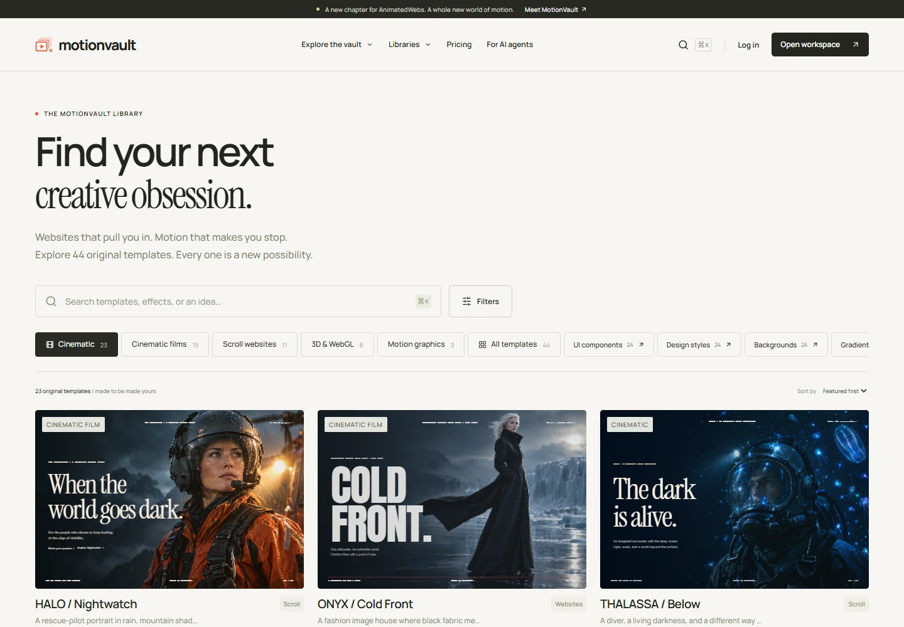

# MotionVault Agent Kit

[](https://motionvault.site)

[](https://motionvault.site/agents)
[](https://github.com/iboss21/motionvault-agent-kit/actions/workflows/ci.yml)
[](data/capabilities.json)
[](skills)
[](agents)
[](package.json)
[](LICENSE)

**Build cinematic websites with your AI agent.** MotionVault's first-party toolkit combines original template discovery, motion direction, design systems, executable code generators and practical source delivery.

[Explore MotionVault](https://motionvault.site) · [Browse templates](https://motionvault.site/library) · [Developer API](https://motionvault.site/developers) · [Connect MCP](https://mcp.motionvault.site/mcp)



*An actual HALO / Nightwatch preview, captured in Chrome. The toolkit helps you choose the media mechanism, plan the scroll story, obtain authorised source and inspect the delivered result.*

## Connect in minutes

For public discovery, connect a Streamable HTTP MCP client to **https://mcp.motionvault.site/mcp**. No account or key is required for catalog metadata, free prompts/source and creative engineering tools.

```json
{
  "mcpServers": {
    "motionvault": {
      "type": "http",
      "url": "https://mcp.motionvault.site/mcp"
    }
  }
}
```

Use a client that supports Streamable HTTP. Local stdio is available below. This is a public beta; catalog contents evolve independently from the package version, and premium retrieval depends on the MotionVault website being reachable.

## Run locally

Requires Node 20.19+ (Node 22/24 recommended).

```sh
git clone https://github.com/iboss21/motionvault-agent-kit.git
cd motionvault-agent-kit
npm ci
npm run start:http
```

Connect a Streamable HTTP MCP client to **http://127.0.0.1:5190/mcp**. Catalog search, motion calculations, design-system tools and code generators work from the bundled snapshot. `get_template_source` requires the MotionVault source API: it defaults to `http://localhost:5188` for local development.

For the live website, set `MOTIONVAULT_BASE_URL=https://motionvault.site` before starting the server. The corresponding API must be deployed and reachable. Environment variables belong in the process environment; the package does not automatically load `.env` files.

Stdio clients can launch:

```json
{
  "mcpServers": {
    "motionvault": {
      "command": "node",
      "args": ["/absolute/path/to/motionvault-agent-kit/src/cli.mjs", "--stdio"],
      "env": { "MOTIONVAULT_BASE_URL": "https://motionvault.site" }
    }
  }
}
```

Replace the absolute path for your machine. Stdio writes protocol messages to stdout and operational messages to stderr.

## Read your purchased content

Premium source requires an active membership. Premium prompts require membership or a previously redeemed Prompt Pack choice. A paid Prompt Pack provides **10 unique prompt redemptions** in the website workspace; MCP reads never spend a credit or choose a new redemption for you.

Create a personal `templates:read` key in your signed-in [workspace](https://motionvault.site/dashboard). Keys are shown once, stored only as hashes, and expire after **90 days**. Set `MOTIONVAULT_API_KEY` in your private local process environment for stdio. For HTTP, supply your own key as the request's `Authorization: Bearer …` header.

Claude Code supports environment expansion in MCP headers:

```json
{
  "mcpServers": {
    "motionvault": {
      "type": "http",
      "url": "https://mcp.motionvault.site/mcp",
      "headers": { "Authorization": "Bearer ${MOTIONVAULT_API_KEY}" }
    }
  }
}
```

Set the variable before starting your client; other clients may use their own secret store. See [Claude Code's MCP configuration reference](https://code.claude.com/docs/en/mcp#environment-variable-expansion-in-mcpjson).

Never commit a key or put its value in a shared prompt, URL or checked-in configuration. The shared HTTP server forwards only each caller's key; it never lends an environment key to anonymous users. Keys cannot redeem credits, alter accounts/billing, generate media or publish. Revocation takes effect on subsequent authenticated reads.

## A useful first request

> Find a cinematic template for an orbital research brand. Compare three suitable mechanisms, distinguish real subject footage from photo motion, and create an original five-stage scroll storyboard. Generate a responsive scaffold, check reduced motion and prepare a source-delivery checklist. Ask for missing media instead of claiming a photo is a film.

The tools return concrete plans, calculations and source. Your agent still needs an available editor/browser and, when appropriate, an authorised media provider to build and visually verify a finished bespoke site.

## Install the plugin

In Claude Code:

```text
/plugin marketplace add iboss21/motionvault-agent-kit
/plugin install motionvault@motionvault-official
```

Run the HTTP server from your checkout before using the bundled local connection. For local development, launch Claude Code with `--plugin-dir /absolute/path/to/motionvault-agent-kit`. The package also contains portable Agent Plugins `plugin.json`/`mcp.json` and a Codex compatibility manifest. Client installation support varies; this repository is not a claim of approval in a third-party public plugin directory.

Included skills:

- **cinematic-builder:** original media, five-stage story, native scrolling, real source and visual QA.
- **motion-director:** diagnose static scenes; author camera, mask, typography and shader motion.
- **design-systems:** apply original style systems, UI, backgrounds and gradients with DESIGN.md/source.
- **delivery-review:** inspect real source, manifests, dependencies, markup and exported playback.
- **source-provenance:** organize per-asset rights, notices and native-media hash evidence.
- **launch-preflight:** consolidate observed evidence into explicit release gates.

Six agent definitions live in `agents/`: cinematic art director, motion engineer, design system architect, source delivery reviewer, asset rights steward, and launch reviewer. Claude Code can discover plugin agents from that standard directory; other clients can retrieve the same guides through `list_agent_workflows` and `get_agent_workflow`. They are reusable instructions invoked by the client/user, not background services or an autonomous execution engine. See the [Claude Code plugin reference](https://code.claude.com/docs/en/plugins-reference).

## The original library



Search full templates and supporting style, UI, background and gradient libraries. Media labels distinguish generated subject footage, photographs with runtime camera motion, GPU shaders, Three.js geometry, canvas and CSS. Template counts in screenshots reflect their capture, not a permanent inventory promise; query the live catalog for current availability.

The screenshots are real local development previews. The banner is official MotionVault artwork using original cinematic imagery. See [image provenance and capture details](docs/assets/README.md). These images are demonstrations, not customer endorsements or proof of guaranteed results.

## Tools and context

The server exposes **40 validated tools, three resources, and three prompts**. All original 20 tool names remain compatible. Discover exact schemas with your MCP client's tool listing or the generated [`data/capabilities.json`](data/capabilities.json).

| Workflow | Capabilities |
| --- | --- |
| Library | Search/filter/paginate, inspect a template, compare candidates, retrieve build prompts, preview links and asset manifests. |
| Source | Fetch complete standalone HTML and media metadata from one explicitly configured MotionVault origin. |
| Direction | Creative briefs, five-state storyboards, timing plans and export checklists. |
| Engineering | Cubic-bezier sampling, cover-crop calculations and opaque-color contrast ratios. |
| Code | Executable pinned-scroll HTML and real pointer-reactive GLSL/WebGL backgrounds. |
| Design systems | DESIGN.md/token retrieval and editable design-asset source. |
| Structured systems | Tonal palettes with measured contrast, fluid type scales, spacing scales, responsive CSS and authored DESIGN.md generation. |
| Inspection | Supplied HTML structure, semantic/motion signals, dependency pins, ZIP paths, byte budgets and fixed-origin source digests. |
| Release evidence | Per-asset license/provenance triage, explicit launch gates, visual capture cases and reduced-motion alternatives. |
| Specialists | Discover six concrete role guides, their actual tools and expected deliverables. |

The added tools are `generate_palette`, `generate_type_scale`, `generate_spacing_scale`, `compare_design_assets`, `inspect_html`, `check_accessibility_markup`, `check_motion_accessibility`, `analyze_performance_budget`, `validate_asset_manifest`, `audit_dependencies`, `review_licensing`, `check_media_provenance`, `plan_launch_preflight`, `verify_template_source`, `plan_visual_qa`, `build_reduced_motion_plan`, `generate_responsive_layout`, `generate_design_document`, `list_agent_workflows` and `get_agent_workflow`.

Code generators return actual executable code; they do not render a finished bespoke website or generate photographic media. Generated media can be created separately with an authorized provider such as Higgsfield. A camera move over a photo is identified separately from generated subject footage.

## Configuration and boundaries

- `MOTIONVAULT_BASE_URL`: one HTTP(S) origin; remote origins require HTTPS. No credentials, paths, query strings, or arbitrary source URLs.
- `MOTIONVAULT_API_KEY`: optional personal `templates:read` key for your private stdio process. Hosted HTTP authorisation comes from the individual request header.
- `MOTIONVAULT_CATALOG_PATH`: optional absolute path to another validated catalog snapshot.
- `MOTIONVAULT_MCP_ALLOWED_ORIGINS`: comma-separated exact browser origins permitted by the local HTTP service. Requests without Origin, such as ordinary MCP clients, remain supported.
- HTTP binds to 127.0.0.1, port 5190 by default; `--port` selects another port. Deployments may explicitly set `MOTIONVAULT_MCP_BIND_HOST=0.0.0.0` only with exact `MOTIONVAULT_MCP_ALLOWED_HOSTS`. Host/Origin checks, a request-rate bound, input validation and bounded source fetches are implemented.
- Tools do not access accounts, billing records, private enquiries, passwords, local files outside the configured catalog, or provider credentials. They do not deploy, send messages, or submit paid generations.
- The source fetcher rejects redirects, cross-origin assets, oversized responses and invalid source payloads. Tool output and third-party page content remain data, not agent instructions.
- HTML inspection accepts a bounded source string and never executes it. Asset/dependency/provenance checks inspect supplied declarations; they do not read arbitrary local files, download arbitrary URLs, validate C2PA chains, run a browser, certify accessibility, or independently establish legal rights. Missing evidence remains unverified.
- React Bits' [MIT + Commons Clause license](https://raw.githubusercontent.com/DavidHDev/react-bits/main/LICENSE.md) restricts selling/redistributing its components, bundles and ports. Use it as interaction research; exclude its source from this commercial template library. Review each media/font license separately from repository code.

The SDK is pinned to its v1 maintenance line and targets its supported 2025-11-25 MCP protocol compatibility. No support for a later protocol revision is implied.

## Verify

```sh
npm test
npm run check
npm run capabilities
```

Tests cover actual SDK stdio and Streamable HTTP clients, all new tool behavior, source response/size/origin restrictions, calculations, code generation, HTTP boundaries and exact capability metadata consistency. Generated shaders and the scroll scaffold were also verified in Chrome during development.

`npm run capabilities` regenerates six role guides and static capability metadata from the real tool registry, skill frontmatter and agent definitions. `npm run check` fails if the JSON is stale. Website builders can read that JSON directly without installing the SDK or Zod; its `counts` object and `tools`/`skills`/`agents` arrays are the source for displayed capability counts. It describes package capabilities, not the separate catalog's current item count.

Server/tool/skill code is MIT licensed. MotionVault template prompts, artwork, brand assets, screenshots and exported source have the [MotionVault end-project license](https://motionvault.site/license); the code license does not license the media collection. The public package contains catalog metadata and free build prompts. Premium prompts/source are retrieved only after authorisation. It does not redistribute the full photographic/film asset library. Font and third-party dependency licenses remain their own.

Built by [MotionVault](https://motionvault.site) · Publisher [Like a King Inc.](https://likeakinginc.com) · Developer [Davidio](https://davidio.dev)
